

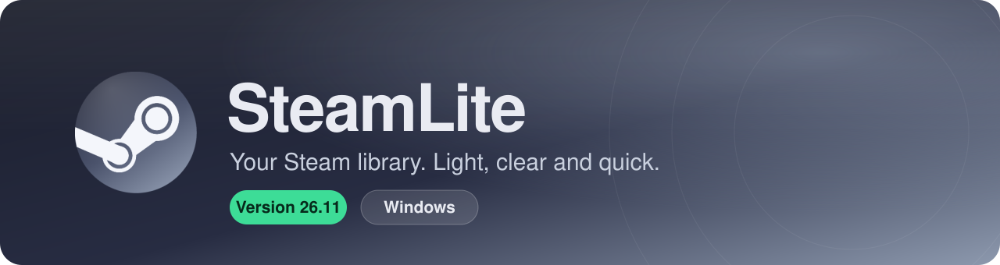

 

**A lighter way to see your Steam library, launch your games and keep count of your time.**

[Download](#download) · [What's new](#whats-new-in-26119) · [Features](#features) · [Screenshots](#screenshots) · [FAQ](#faq) · [Changelog](CHANGELOG.md)

 

## What's new in 26.11.9

Versions are the **year and the month**, so this is the **26.11** line, and 26.11.9 is the latest.

|  |  |
|---|---|
| **Play stats** | Your time in games by week, month or all time: streaks, most played games, the hours and weekdays you play most, and a 17-week calendar. |
| **A profile you can edit** | A new Profile page with a banner, picture, tagline and colour of your own. Hide or reorder the widgets. |
| **A friends drawer** | Your Steam friends in a side panel: who is playing what, who is online. Friends with a SteamLite profile are marked. |
| **Discord Rich Presence** | The game you play, with its art and a live timer, and real numbers like achievements and your streak. Off until you turn it on. |
| **Smart library** | A setting that keeps only games in your library, without other Steam apps like Wallpaper Engine. |
| **A faster start** | The library appears at once from the saved copy, then updates from Steam. |
| **Steam not running** | Press Play with Steam closed and SteamLite starts it, then launches the game. |
| **Filters menu** | Sort options and the cover-size slider in one menu in the Library. |
| **Close to the tray, pause while you play, navigation sounds** | Optional settings, all off by default. |
| **Go back to stable** | On a beta build, a button in Settings returns you to the stable version. |
| **A fixed installer** | Setup no longer needs administrator rights. |
| **Connect Discord** | Link the Discord account signed in on your PC. It shows on your Profile page. A live preview in Settings shows how your Rich Presence card will look. |
| **A reworked Themes section and a Discord theme** | Every theme is a small picture of the app in its own colours. The new Discord theme is charcoal and blurple, with Discord green for Play. |
| **A smoother switch** | Switches in Settings slide straight away, with a small spring. |
| **A Christmas theme** | Unlocks in Settings on December 1 and stays until January 1, with snow you can turn off. |
| **The GTA 6 theme ends early** | It is available until 27 November 2026, and SteamLite says so every time it opens until then. |

> [!NOTE]
> **Coming from 10.x?** Install the latest version over it. Your settings, favorites, collections and play time are read from the same place as before, and you sign in with Steam once.

 

## Screenshots

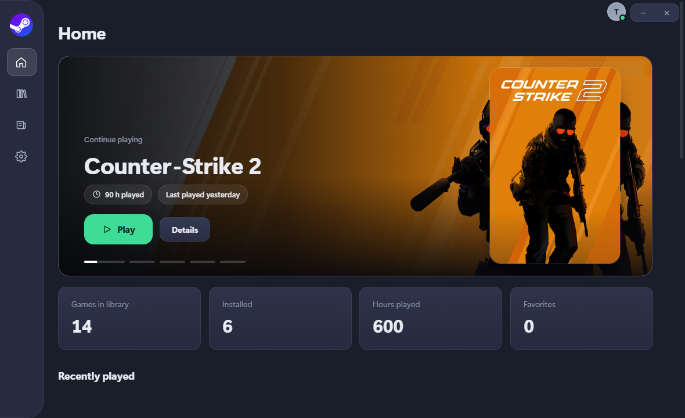 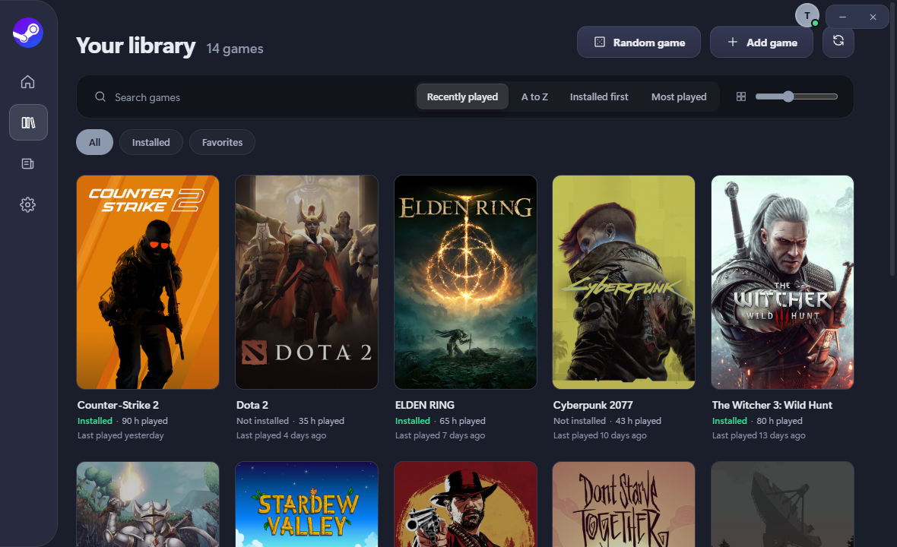
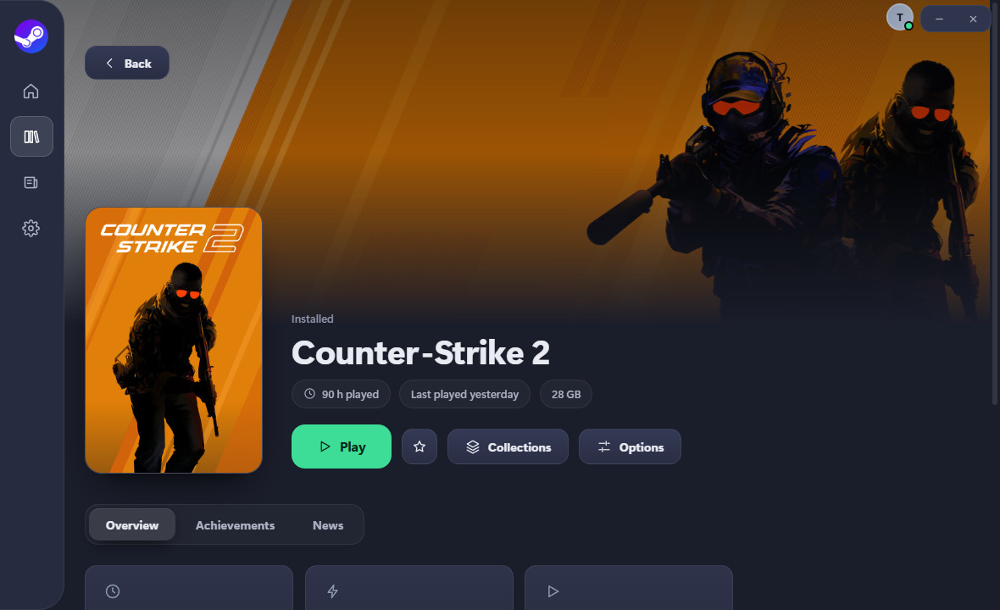 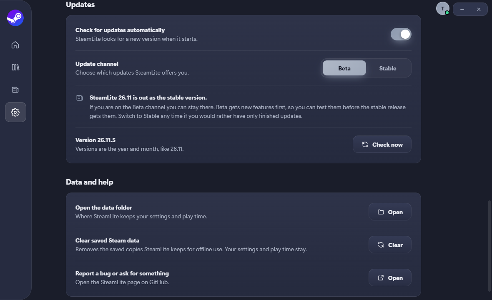
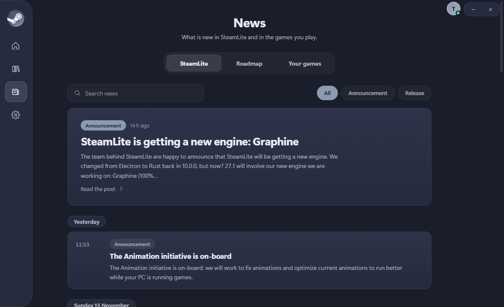 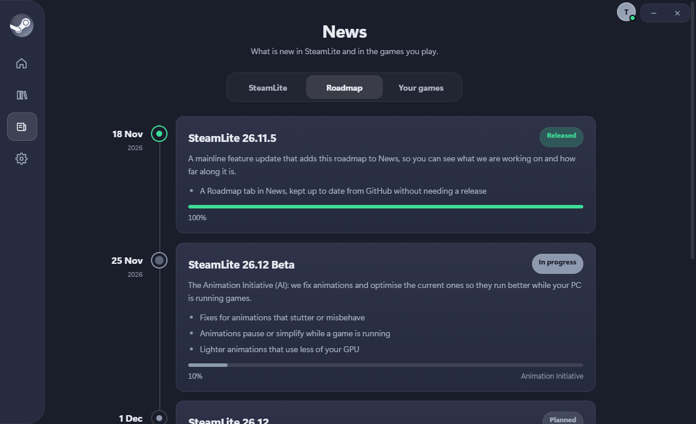
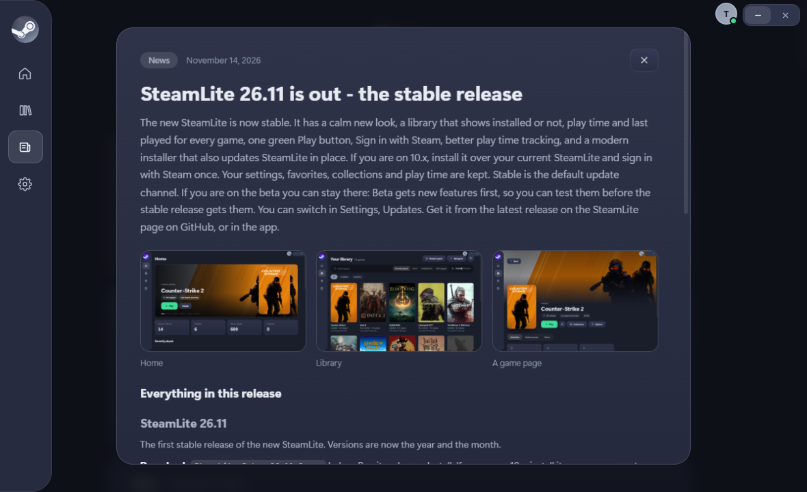 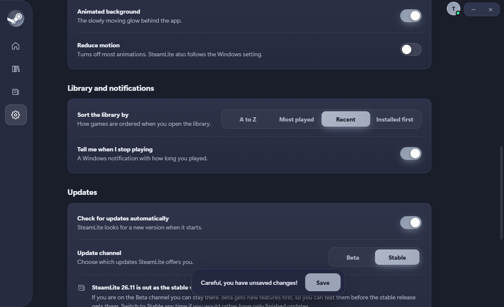
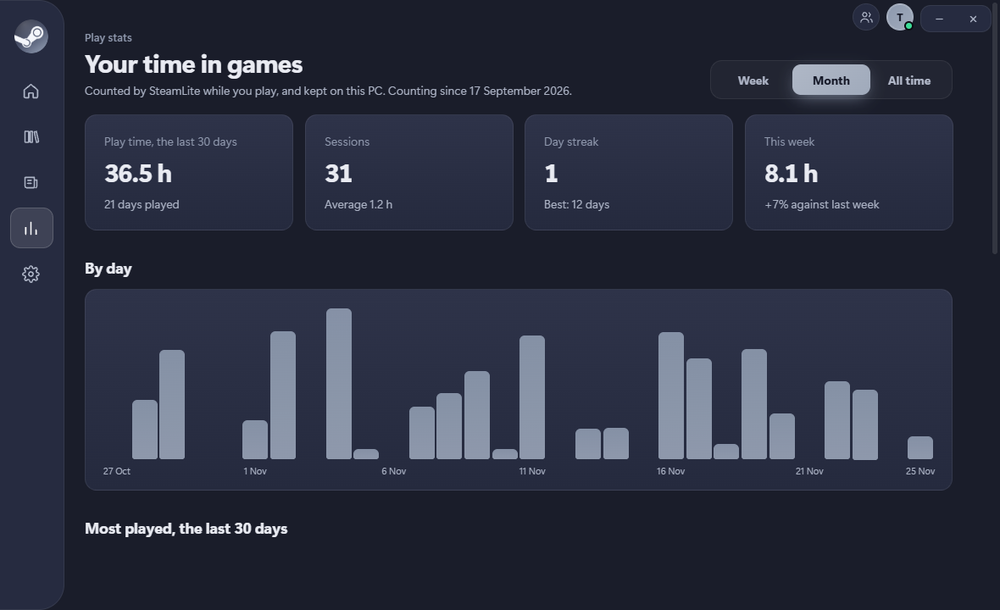 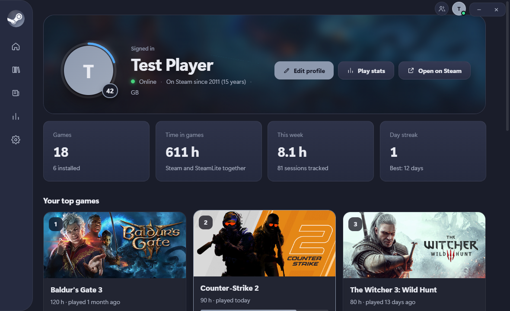

Home · Library · a game page · Settings · News · Roadmap · a news post opened in full · the unsaved changes bar · Play stats · a profile (test account, made-up data)

 

## Features

<table>
<tr>
<td width="50%" valign="top">

### Your library
Press **/** or **Ctrl+F** to search from any page. Covers in a clean grid, with **Installed / Not installed**, play time and *last played* under each one. Instant search, sorting (**recently played, A to Z, installed first, most played**), filters and a cover size slider.

</td>
<td width="50%" valign="top">

### Play and Stop
One green **Play** button per game, and **Stop** while it runs. SteamLite follows a game even when a launcher starts it and then closes.

</td>
</tr>
<tr>
<td valign="top">

### Play time
Counted from the moment a game is really running until it closes. Steam games you start from Steam itself are noticed too.

</td>
<td valign="top">

### Collections and favorites
Group games your way, mark favorites, hide what you never play. Launch options and *run as administrator* are saved per game.

</td>
</tr>
<tr>
<td valign="top">

### Any game
Add games that are not on Steam, and have their play time counted too.

</td>
<td valign="top">

### News, Roadmap and updates
SteamLite news (featured, searchable and listed by when it was published) and the latest news from the games you play, in one place. Click a post and it opens in full, with its notes and pictures. The **Roadmap** tab shows what is coming next and how far along it is. After an update, SteamLite shows what changed the first time it opens.

</td>
</tr>
<tr>
<td valign="top">

### Updates built in
When there is a new version, **Update now** closes SteamLite, updates it in place and opens it again. Choose **Stable** or **Beta** in Settings.

</td>
<td valign="top">

### Island support
Show your game, its timer and a Stop button in **Island**, a separate small app that sits at the top of your screen. Turn it on or off in Settings.

</td>
</tr>
<tr>
<td valign="top">

### Play stats
Hours per day, your most played games as cards, streaks, the times and days you play most, and a calendar of the last 17 weeks. Worked out on your PC.

</td>
<td valign="top">

### Profile and friends
Make your profile yours: picture, banner, tagline, colour and widgets. A friends drawer shows who is playing what, and friends with a SteamLite profile can be opened to see theirs. Sharing your own is your choice.

</td>
</tr>
<tr>
<td valign="top">

### Discord
Show the game you are playing on Discord, with its art and a live timer, and rotating numbers from your library, with a live preview of the card. Connect your Discord account to show it on your profile. Each part can be switched off, and game names can be hidden.

</td>
<td valign="top">

### A library that stays clean
Soundtracks, demos and tools are hidden by default. **Smart library** goes further and keeps only games.

</td>
</tr>
<tr>
<td colspan="2" valign="top">

### Settings you can trust
Changes wait until you press **Save**. A bar tells you when something is unsaved, so nothing changes by accident. **Settings, Themes** lets you try a look before you save it, and **Copy diagnostics** puts the details for a bug report on your clipboard.

</td>
</tr>
</table>

 

## Download

1. Get the **SteamLite installer** (`SteamLite.Setup.<version>.exe`) from the [latest release](https://github.com/imnotfisy/SteamLite/releases/latest).
2. Run it and press **Install**. It installs just for you, so it normally needs no administrator rights.
3. Open SteamLite and **Sign in with Steam**.

<b>Requirements</b>

- Windows 10 or 11 (64-bit)
- Microsoft Edge WebView2 (the installer sets it up if it is missing)
- A Steam account. Your Steam profile's **game details** must be public for SteamLite to read your library.

 

## Stable and Beta

| Channel | What you get |
|---|---|
| **Stable** *(default)* | Finished, tested releases only. |
| **Beta** | New features first, before the stable release gets them. May have rough edges. |

Switch any time in **Settings → Updates**. If you are on the Beta channel you can stay there, and a beta build has a **Go back to stable** button that installs the newest stable version.

 

## FAQ

<b>Is it safe to sign in?</b>

SteamLite opens Steam's own sign-in page in your browser. It never sees your password. The sign-in is confirmed through the SteamLite server, and the token it saves is protected by Windows.

<b>Why does it ask for a Steam Web API key?</b>

To read your game list, Steam needs a free Web API key. SteamLite asks once and saves it to your account.

<b>My library is empty.</b>

Set **Game details** to **Public** in your Steam privacy settings, then press refresh in the library.

<b>What happened to Messages and the overlay?</b>

To keep SteamLite focused, Messages, the in-game overlay, streaks, the rewards system and cloud backup are not in 26.11. Profiles, a friends drawer, themes and Discord presence have come back. If you rely on the rest, 10.1.5 is still available on the [releases page](https://github.com/imnotfisy/SteamLite/releases/tag/v10.1.5).

<b>Where is my data?</b>

In `%APPDATA%\SteamLite` on your PC. **Settings → Data and help → Open the data folder** takes you there.

 

## Help and feedback

- Found a bug or want something added? [Open an issue](https://github.com/imnotfisy/SteamLite/issues).
- Want to chat or get quick help? [Join the SteamLite Discord](https://discord.gg/kBzXWQevw5).
- See what changed in every version in the [changelog](CHANGELOG.md).
- Website: <https://imnotfisy.github.io/SteamLite/>

 

SteamLite is not affiliated with or endorsed by Valve. Steam and the Steam logo are trademarks of Valve Corporation.
 
Made with care · [MIT license](LICENSE)

