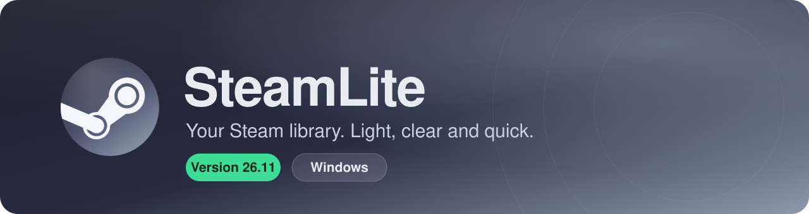
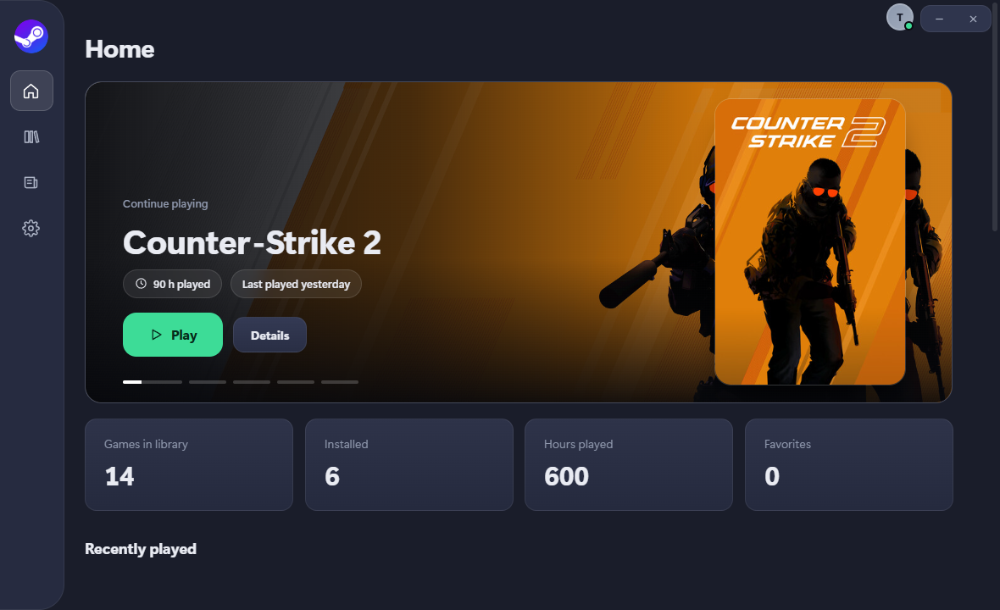
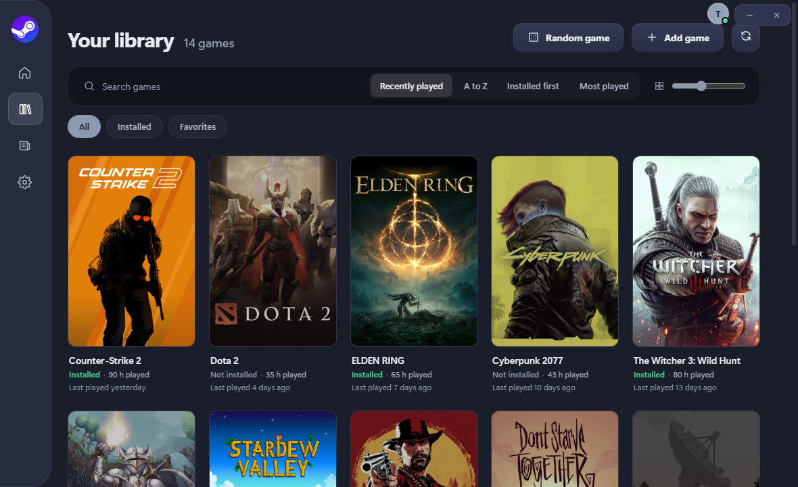
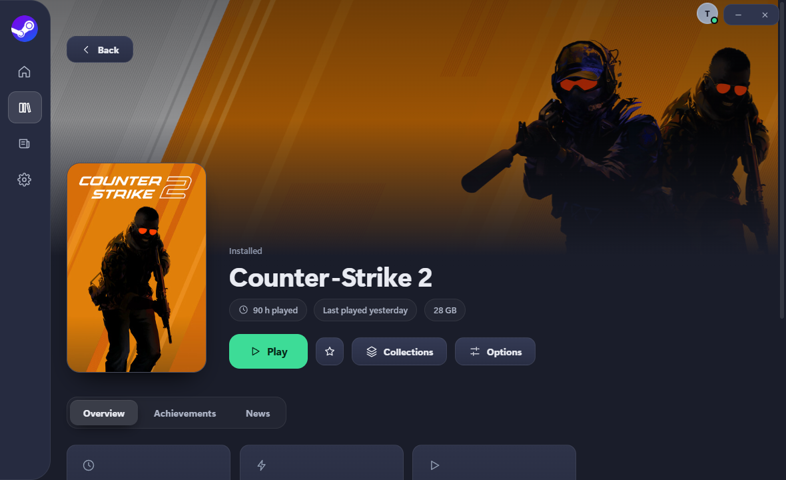
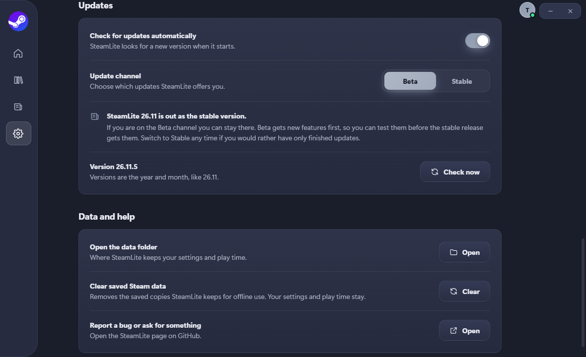

 

**A lighter way to see your Steam library, launch your games and keep count of your time.**

[Download](#download) · [What's new](#whats-new-in-2611) · [Features](#features) · [Screenshots](#screenshots) · [FAQ](#faq) · [Changelog](CHANGELOG.md)

 

## What's new in 26.11

SteamLite is rebuilt from the ground up. Versions are now the **year and the month**, so this is **26.11**.

|  |  |
|---|---|
| **A new look** | A calm dark design, plain 2:3 covers and one green **Play** button on every game. |
| **Sign in with Steam** | Steam's own sign-in page. SteamLite never sees your password. |
| **A clearer library** | Installed or not, play time and last played, on every game. Search, sort and filter in a click. |
| **Better play tracking** | Counts games started through a launcher, and Steam games started from Steam itself. |
| **A modern installer** | One window that also **updates SteamLite in place**. |
| **Stable and Beta** | Stable by default. Switch to Beta to try new features first. |

> [!NOTE]
> **Coming from 10.x?** Install 26.11 over it. Your settings, favorites, collections and play time are read from the same place as before, and you sign in with Steam once.

 

## Screenshots

 
 

Home · Library · a game page · Settings

 

## Features

<table>
<tr>
<td width="50%" valign="top">

### Your library
Covers in a clean grid, with **Installed / Not installed**, play time and *last played* under each one. Instant search, sorting (**recently played, A to Z, installed first, most played**), filters and a cover size slider.

</td>
<td width="50%" valign="top">

### Play and Stop
One green **Play** button per game, and **Stop** while it runs. SteamLite follows a game even when a launcher starts it and then closes.

</td>
</tr>
<tr>
<td valign="top">

### Play time
Counted from the moment a game is really running until it closes. Steam games you start from Steam itself are noticed too.

</td>
<td valign="top">

### Collections and favorites
Group games your way, mark favorites, hide what you never play. Launch options and *run as administrator* are saved per game.

</td>
</tr>
<tr>
<td valign="top">

### Any game
Add games that are not on Steam, and have their play time counted too.

</td>
<td valign="top">

### News
SteamLite news and the latest news from the games you play, in one place.

</td>
</tr>
<tr>
<td valign="top">

### Updates built in
When there is a new version, **Update now** closes SteamLite, updates it in place and opens it again. Choose **Stable** or **Beta** in Settings.

</td>
<td valign="top">

### Island support
Show your game, its timer and a Stop button in **Island**, a separate small app that sits at the top of your screen. Turn it on or off in Settings.

</td>
</tr>
</table>

 

## Download

1. Get **`SteamLite.Setup.26.11.0.exe`** from the [latest release](https://github.com/imnotfisy/SteamLite/releases/latest).
2. Run it and press **Install**. It installs just for you, so it normally needs no administrator rights.
3. Open SteamLite and **Sign in with Steam**.

<b>Requirements</b>

- Windows 10 or 11 (64-bit)
- Microsoft Edge WebView2 (the installer sets it up if it is missing)
- A Steam account. Your Steam profile's **game details** must be public for SteamLite to read your library.

 

## Stable and Beta

| Channel | What you get |
|---|---|
| **Stable** *(default)* | Finished, tested releases only. |
| **Beta** | New features first, before the stable release gets them. May have rough edges. |

Switch any time in **Settings → Updates**. If you are on the Beta channel you can stay there.

 

## FAQ

<b>Is it safe to sign in?</b>

SteamLite opens Steam's own sign-in page in your browser. It never sees your password. The sign-in is confirmed through the SteamLite server, and the token it saves is protected by Windows.

<b>Why does it ask for a Steam Web API key?</b>

To read your game list, Steam needs a free Web API key. SteamLite asks once and saves it to your account.

<b>My library is empty.</b>

Set **Game details** to **Public** in your Steam privacy settings, then press refresh in the library.

<b>What happened to Messages, themes and the overlay?</b>

To keep SteamLite focused, these are not in 26.11: Messages and friends, themes, the in-game overlay, streaks, the rewards system, cloud backup and Discord presence. If you rely on them, 10.1.5 is still available on the [releases page](https://github.com/imnotfisy/SteamLite/releases/tag/v10.1.5).

<b>Where is my data?</b>

In `%APPDATA%\SteamLite` on your PC. **Settings → Data and help → Open the data folder** takes you there.

 

## Help and feedback

- Found a bug or want something added? [Open an issue](https://github.com/imnotfisy/SteamLite/issues).
- See what changed in every version in the [changelog](CHANGELOG.md).
- Website: <https://imnotfisy.github.io/SteamLite/>

 

SteamLite is not affiliated with or endorsed by Valve. Steam and the Steam logo are trademarks of Valve Corporation.
 
Made with care · [MIT license](LICENSE)

