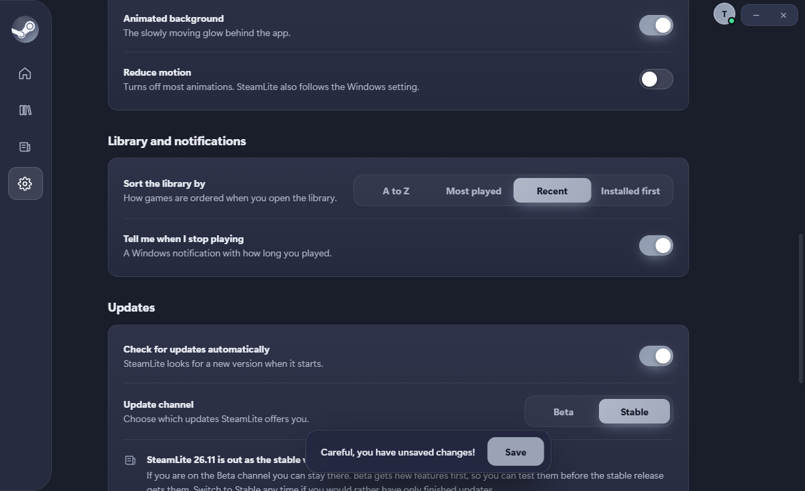

A small update to the stable release. SteamLite has a new icon: the same mark, now in the app's grey gradient instead of purple and blue. Settings now has a Save button: changes wait until you press Save, and a bar at the bottom says "Careful, you have unsaved changes!" with the Save button next to it. The beta, 26.11.7.beta, has the same changes. Update from inside SteamLite, or get the installer from the latest release on GitHub.

