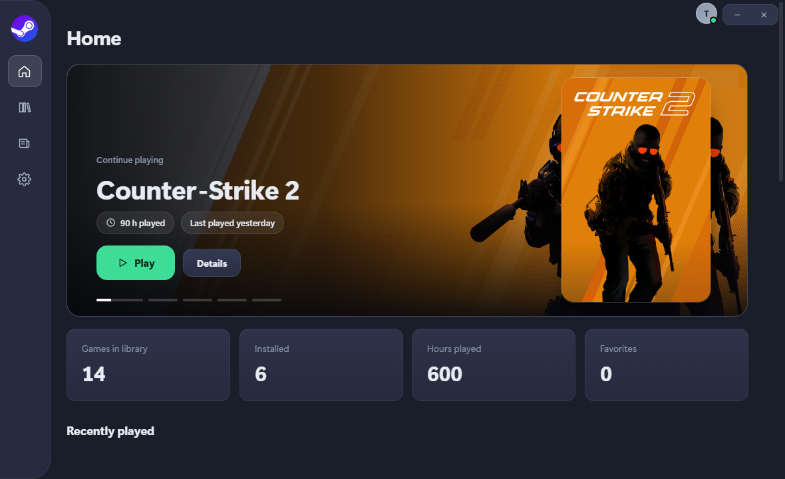
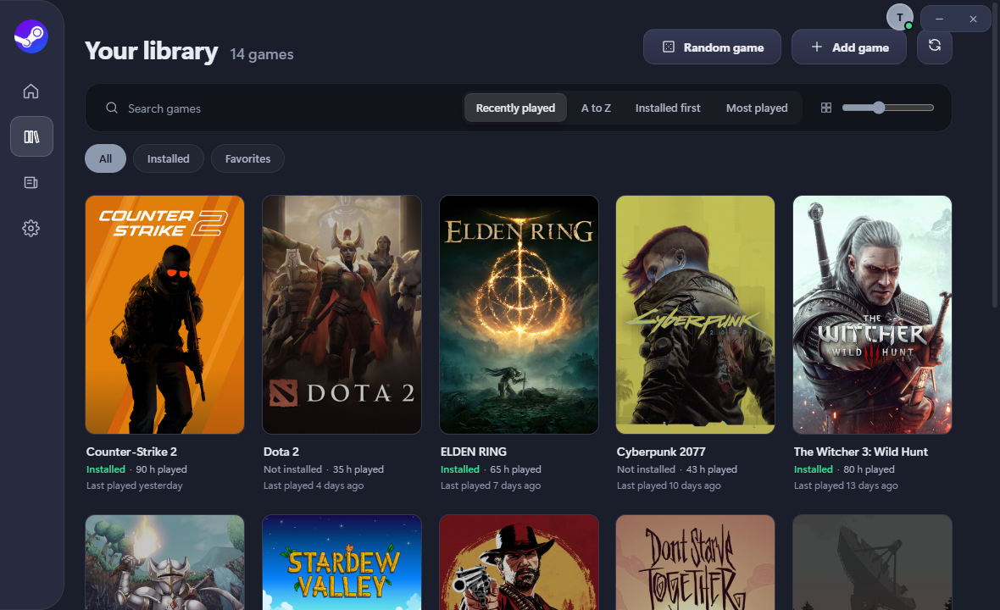
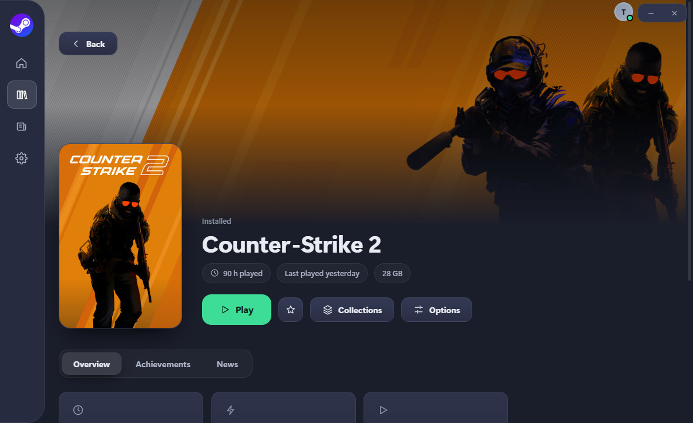

The new SteamLite is now stable. It has a calm new look, a library that shows installed or not, play time and last played for every game, one green Play button, Sign in with Steam, better play time tracking, and a modern installer that also updates SteamLite in place. If you are on 10.x, install it over your current SteamLite and sign in with Steam once. Your settings, favorites, collections and play time are kept. Stable is the default update channel. If you are on the beta you can stay there: Beta gets new features first, so you can test them before the stable release gets them. You can switch in Settings, Updates. Get it from the latest release on the SteamLite page on GitHub, or in the app.

