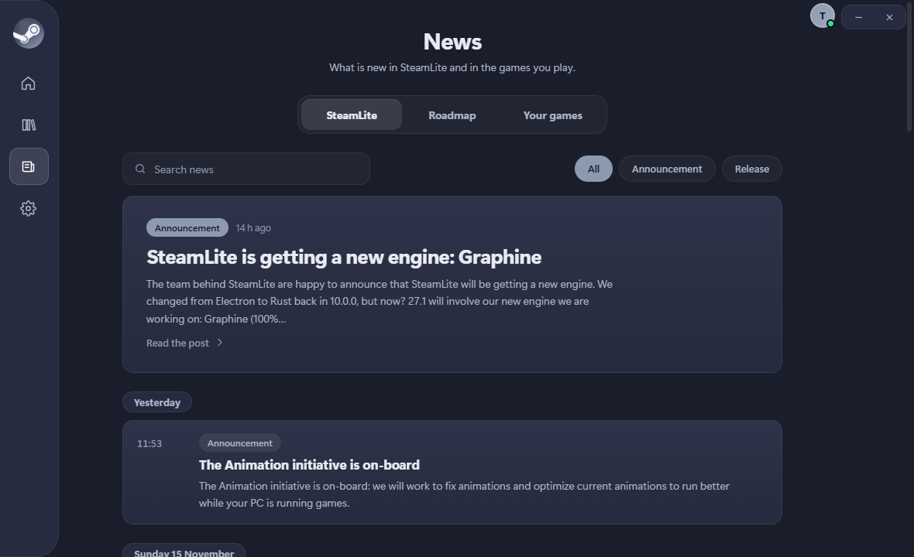
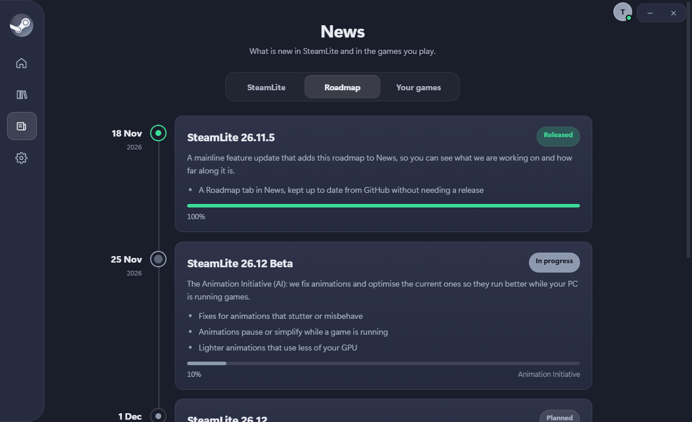

SteamLite 26.11.5 is a feature update with a completely reworked News page, and a **Roadmap** so you can see what we are working on.

## What is new

- **A new News page.** The newest post is featured at the top, and every post is listed under the day and time it was published. You can search the news and filter it by Announcement, Release or Update. Posts you have not seen yet are marked **New**.
- **News is now written in Markdown.** Posts can have headings, lists, quotes, tables, links and pictures, and you can click a picture to see it full size.
- **A Roadmap tab in News.** See what is coming next, when, and how far along it is. It is kept up to date from GitHub, so it can change without a new release.

## The plan

| Date | Release |
|---|---|
| 25 Nov | 26.12 Beta, with the Animation Initiative |
| 1 Dec | 26.12 |
| 15 Dec | 27.1 Beta, with Graphine, only if the engine is stable and tested |

Open the **Roadmap** tab to follow the progress.
