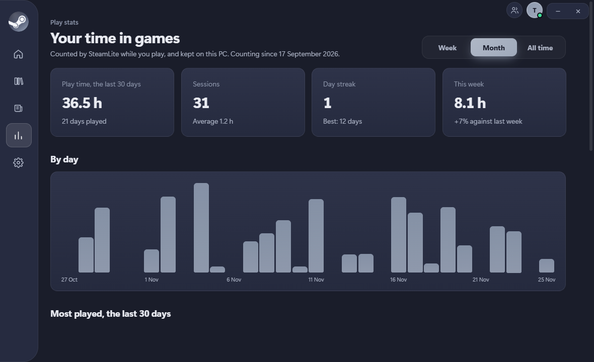
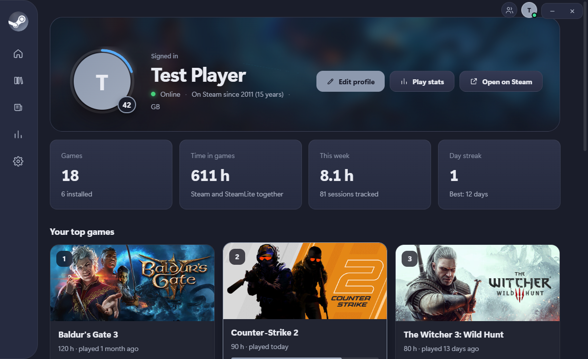

SteamLite 26.11.7 is out. It is a big update: a faster start, play stats, a profile you can edit, a friends drawer, Discord presence and a lot of small things that get in your way less. The Christmas theme is inside too, and it unlocks on December 1.

## What is new

- **Faster start.** Your library appears straight away from the saved copy, then updates when Steam answers.
- **Play stats.** A new Stats page shows your time in games by week, month or all time, with your day streak, your most played games as cards, the hours and weekdays you play most, and a calendar of the last 17 weeks. It is worked out on your PC.
- **A new Profile page you can edit.** A banner from your most played game (or two colours, or your own picture), your avatar with a ring that fills as your Steam level grows, a tagline and a colour of your choice. You can hide the widgets you do not want and put the rest in the order you like.
- **A friends drawer.** A button next to your picture opens your Steam friends in a panel at the side: who is playing what, who is online, and when the others were last seen. Friends who have a SteamLite profile are marked, and opening one shows their banner, picture, tagline and top games. It goes away when you click off it or change page.
- **Discord Rich Presence is back.** Off until you turn it on in Settings. While you play, your profile shows the game with its art and a live timer, and rotates through real numbers from your library: achievements, play time, your streak and where the game ranks.
- **Smart library.** A new setting that keeps only games in your library, so apps like Wallpaper Engine are left out.
- **A Filters menu in the Library.** The sort options and the cover-size slider now live in one menu, so the toolbar fits in a narrow window.
- **Steam not running.** Press Play with Steam closed and SteamLite starts Steam, then launches the game when it is ready.
- **Disk usage, download progress and multi-select.** See how much space your games take, watch downloads on the cards, and Ctrl or Shift click to favorite, hide or collect several games at once. Undo is a click away.
- **Close to the tray, pause while you play and navigation sounds.** All optional, all off by default.
- **A fixed installer.** Setup no longer needs administrator rights.
- **Go back to stable.** On a beta build, Settings has a button that returns you to the stable version.

The pictures show a test account with made-up data.

## Your SteamLite account

Signing in with Steam already makes your SteamLite account and links it to your Steam account. After you sign in, SteamLite says so once and asks whether other players may see your profile. Nothing is shared until you choose, and you can change it later in Settings.

## On December 1

A new theme unlocks in Settings on December 1 and stays until January 1. That is SteamLite 26.12, and it changes nothing else. Open the **Roadmap** tab to follow it.
